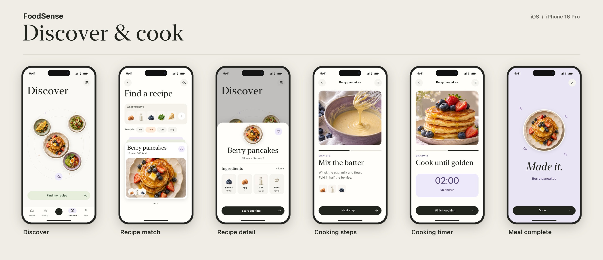

# FoodSense

**Independent client commission · Shangcheng (Katherine) Lin**

I independently accepted the FoodSense design commission and developed it from the supplied brief and research inputs into a working browser prototype and a 25-screen iOS design. I owned the product definition, the interaction and visual design, and the prototype delivery.

FoodSense helps budget-conscious international residents in Sydney look inside a shared fridge, see which groceries to use first, and decide what to cook. The iOS concept pairs with **Javic**, a proposed in-fridge device that supplies shelf images and suggests items for the cook to review.

[Commission brief in English](docs/commission-brief.md) · [Download project and prototypes](https://github.com/katherine0292/foodsense/archive/refs/heads/main.zip) · [Delivery walkthrough](docs/delivery.md)

## What the client commissioned

The brief asked for a mobile experience connected to an in-fridge device, focused on three moments: **putting groceries away**, **checking what is available on the way home**, and **cooking dinner**. The deliverables were two interview records, a representative persona, a device and app proposal with use scenarios, paper and high-fidelity iOS designs, and clickable browser demos. It allowed sample data for device connections, detections and recommendations.

I focused the scope on a decision the cook could complete: confirm what is in the fridge, identify what needs using, and choose a meal they can make with it. That gave each feature a role in the same journey.

## How the research shaped the product

| Evidence from the supplied research | Design response |
| --- | --- |
| A resident who hosts regularly said leftover ingredients often disappear behind other groceries in a shared fridge. | Show shelf views and surface **Use first** on Today so the cook can find items without searching the whole fridge. |
| A frequent solo cook stopped using inventory apps after a few days because entering use-by dates took too much effort. | Present detected groceries as a batch the cook can confirm or skip. Keep manual entry available for missed or uncertain items. |
| Both accounts showed how hard it is to decide what to make when plans change or ingredients are out of sight. | Show cooking time, ingredient coverage and missing items before the cook commits to a recipe. Connect near-date ingredients to relevant dishes. |
| The composite persona cooks for one most weekdays with limited time and storage. | Let the cook adjust servings, follow one step at a time, and confirm which ingredients were fully used before removing them from inventory. |

The two interviews provided qualitative design inputs. [Read the interview records and Wei Lin persona](docs/research/README.md) or [follow Maya's dinner scenario](docs/scenarios.md).

## How FoodSense and Javic work together

1. **Observe.** The proposed Javic camera captures a shelf image and suggests ingredients. The app lets the cook inspect the snapshot and the suggested items.
2. **Confirm.** Only the items the cook selects are added to inventory. Manual entry and editing cover missing items, quantities and dates.
3. **Prioritise.** FoodSense shows recorded use-by dates and groups near-date foods in **Use first**. The electronic nose in the proposal would supply an experimental shelf-level cue for the cook to investigate.
4. **Decide and cook.** The recipe match compares available ingredients and uses near-date items as a ranking signal. The recipe detail shows what is missing, followed by step-by-step instructions and a timer. The cook confirms any inventory removals at the end.

The browser prototype uses simulated shelf data and detections, and ranks a fixed recipe catalogue in the browser. Its timers, inventory, favourites and shopping list work in the demo. The electronic nose, live hardware and recognition model are proposal scope. The early browser demo shows the voice guidance toggle as an interface state. [System design, recovery paths and pilot measures](docs/product-proposal.md)

## Try the prototypes

[Download the repository ZIP](https://github.com/katherine0292/foodsense/archive/refs/heads/main.zip), extract it, and open the HTML file listed below in a browser. The GitHub file view shows the source.

| Prototype | Open locally | What to try |
| --- | --- | --- |
| **Final iOS demo** | [prototypes/ios/index.html](prototypes/ios/index.html) | Review a sample scan, filter the pantry, match a recipe and cook berry pancakes. The screen index opens all 25 iOS states. |
| **Early browser demo** | [prototypes/early-demo/index.html](prototypes/early-demo/index.html) | Inspect Javic's shelves, look through the alerts and follow the egg fried rice flow with its voice guidance control. |
| **Interaction exploration** | [prototypes/exploration/index.html](prototypes/exploration/index.html) | Compare an alternative layout for inventory, device and recipe browsing. |

To walk through the final demo, start with **Add food → Scan groceries → Review food**, then open **Today → Use first** to compare spinach approaching its date with yoghurt past its recorded date. Go to **Today → Explore → Find my recipe** to compare matches, check what is missing and start the step timer.

## Delivery and evaluation

The project includes [ten paper screens](prototypes/paper/README.md), [25 iOS exports and four flow boards](prototypes/high-fidelity/README.md), and the three interactive versions above. The [delivery walkthrough](docs/delivery.md) maps the brief's requirements to specific screens and demo paths. The [design case study](docs/case-study.md) documents the design evolution and my rationale.

For a pilot, I would test whether people notice and correct incorrect detections, how long it takes to confirm groceries or choose a feasible meal, and whether they understand why a recipe was suggested. Comparing these behaviours with manual entry would inform whether to expand the recognition and hardware scope. Waste and cost reduction remain hypotheses to measure.
