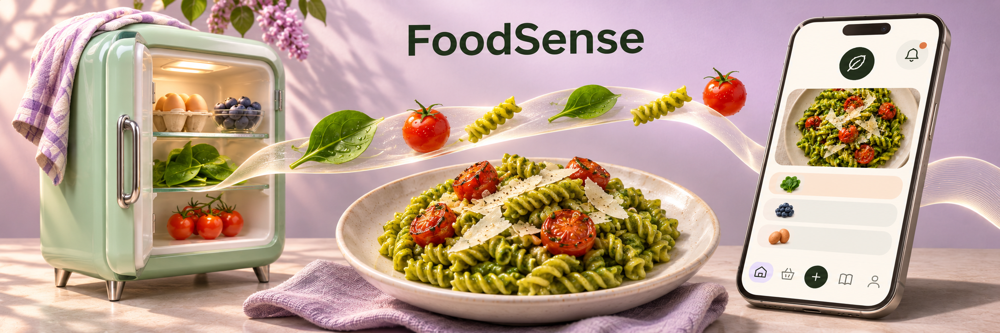

# FoodSense

**iOS UI/UX design for an AI-assisted fridge inventory and cooking app · Independent client commission · Katherine Lin**

[Portfolio page](index.html) · [Final iOS prototype](prototypes/ios/index.html) · [Delivery walkthrough](docs/delivery.md) · [Design case study](docs/case-study.md)

## Summary

FoodSense helps budget-conscious international residents in Sydney see what is in a shared fridge, know what to use first and choose a meal they can cook. The concept pairs an iPhone app with Javic, a proposed in-fridge camera that supplies shelf images and suggests items for the cook to review.

| | |
|---|---|
| **Role** | UI/UX designer: interaction design, visual design, prototyping |
| **Client input** | Commission brief and two interview records |
| **Users** | Residents with limited storage, a fixed budget and a shared fridge |
| **Platform** | iOS, iPhone 16 Pro canvas (402 × 874 pt) |
| **Deliverables** | Persona and scenario · 10 paper screens · 25 iOS screens in four flows · 3 clickable prototypes |
| **AI scope** | Interface design for a recognition feature: how detections are shown, reviewed and corrected. The device and model are proposal scope and were not built. |

## Design problem

How can someone go from “what is in there?” to “I know what I am cooking” without logging every item? The brief named three moments: putting groceries away, checking stock on the way home, and cooking dinner. I narrowed the scope to one decision the cook can finish: confirm what is in the fridge, identify what to use first, choose a feasible meal.

## Research to design

Both interviews were supplied with the brief. I synthesised them into a composite persona (Wei Lin) and used it to set what each screen must do. Two records support hypotheses only, not prevalence.

| Observation | Design response |
|---|---|
| Leftovers disappear behind other groceries in a shared fridge. | Shelf views, and a **Use first** list on Today. |
| Manual date entry is abandoned within days. | Detected groceries arrive as a batch to confirm or skip. Manual entry stays as the fallback. |
| Deciding what to cook is hard when plans change and food is out of sight. | Recipe cards show time, ingredient coverage and what is missing before the cook commits. |
| One cook, limited time and space. | Adjustable servings, one step at a time, and a check on what was used up before it leaves the pantry. |

## Designing for an uncertain detection

The interface treats recognition as a draft the cook can verify, not as a fact.

| Situation | Interface behaviour |
|---|---|
| Detection is uncertain, hidden or duplicated | Shown as a draft to tick or skip. Nothing is added automatically. |
| Camera cannot see quantity, date, owner or allergens | Fields stay editable. Manual entry is always available. |
| Recorded date and a sensor cue disagree | Shown separately. The date is the date. The cue only prompts a look and never states that food is safe. |
| Shelf snapshot is old | Labelled as old. A later scan never overwrites an item the cook edited. |
| Device offline or missing | Manual entry works without it. |

The [product proposal](docs/product-proposal.md) specifies the system behaviour and boundaries.

## Key flows

| Flow | Screens | Where to look |
|---|---|---|
| Start and pantry | Welcome, Today, Use first, Pantry, Ingredient | [Board 01](prototypes/high-fidelity/boards/01-start-and-pantry.jpg) |
| Add and scan | Add food, Manual entry, Scan, Review food, My fridge, Pantry updated | [Board 02](prototypes/high-fidelity/boards/02-add-and-scan.jpg) |
| Discover and cook | Discover, Recipe match, Recipe detail, Steps, Timer, Meal complete | [Board 03](prototypes/high-fidelity/boards/03-discover-and-cook.jpg) |
| Cookbook and profile | Saved recipes, Shopping list, Preferences, Edit profile | [Board 04](prototypes/high-fidelity/boards/04-cookbook-and-you.jpg) |

## Deliverables

| Deliverable | Contents |
|---|---|
| [Final iOS prototype](prototypes/ios/index.html) | Review a sample scan, filter the pantry, match a recipe and cook berry pancakes. The screen index opens all 25 states. |
| [Early browser demo](prototypes/early-demo/index.html) | Javic shelves, alerts and the egg fried rice flow with a voice guidance control. |
| [Interaction exploration](prototypes/exploration/index.html) | An alternative layout for inventory, device and recipe browsing. |
| [Paper prototype](prototypes/paper/README.md) | Ten sketched screens from Home to Meal complete. |
| [iOS design boards](prototypes/high-fidelity/README.md) | 25 screens at 3× and four flow boards. |
| [Research](docs/research/README.md), [scenarios](docs/scenarios.md), [commission brief](docs/commission-brief.md) | Interview records, persona, dinner scenario, scope and acceptance criteria. |

To try the main flow, open the final prototype and go to **Add food → Scan groceries → Review food**, then **Today → Use first**, then **Today → Explore → Find my recipe**.

## Evaluation plan

Moderated tasks with realistic shelf photographs and mixed detection quality. Measure whether people notice and correct wrong detections, time to confirm groceries or choose a feasible meal against manual entry, and whether they understand why a recipe was suggested. A small in-home pilot would then examine inventory upkeep and how often a suggested meal uses a near-date item. Waste and cost reduction are hypotheses until measured.

## Scope and limits

- **Working in the prototypes:** timers, pantry add, edit and remove, shopping list, favourites, step navigation (all in the browser).
- **Simulated:** Javic output and detections, recipe ranking from a fixed catalogue, the voice guidance switch.
- **Not built:** the recognition model, the electronic nose, live device sync.

## Repository

| Path | Contents |
|---|---|
| `index.html`, `img/`, `site-src/` | Portfolio page (English and Chinese). The live `index.html` now includes later additions (research evidence, paper prototype wall, pointer animation) that `site-src/` does not build, so edit `index.html` directly; `site-src/` rebuilds the earlier version only. |
| `prototypes/` | Final iOS prototype, early demo, exploration, paper and high-fidelity exports |
| `docs/` | Brief, case study, proposal, scenarios, research, delivery walkthrough |
| `assets/` | Persona panel and dinner storyboard |

Open any HTML file directly in a browser. Everything runs locally.

## Prototype walkthrough

[Watch the complete walkthrough at the end of the portfolio](index.html#c-video) · [Download the MP4](media/foodsense-walkthrough.mp4)

A continuous recording of the clickable high-fidelity prototype, framed to the phone only. Follow pantry and freshness checks, grocery scanning and manual entry, fridge shelves, recipe matching, saved recipes and shopping, guided cooking with the timer, and profile preferences. Tap highlights make the actions visible.

The recording uses the prototype's sample data and simulated device output.
